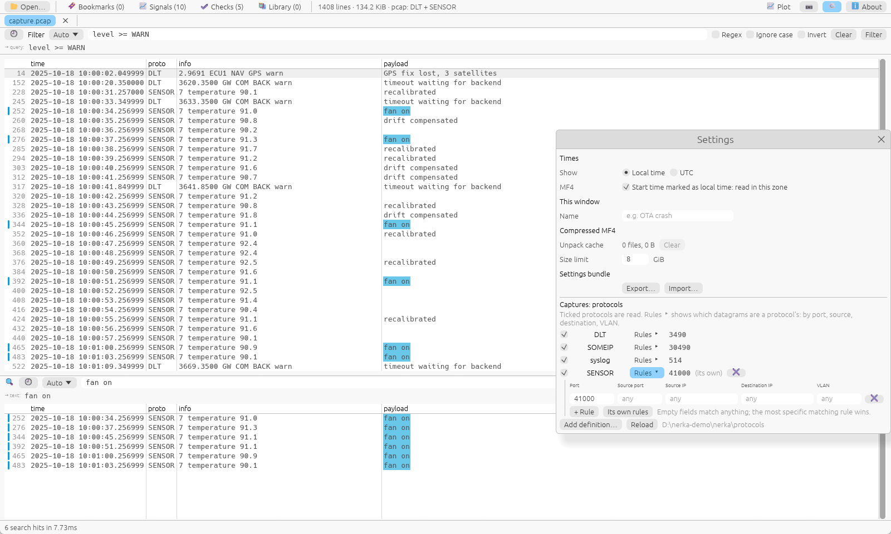
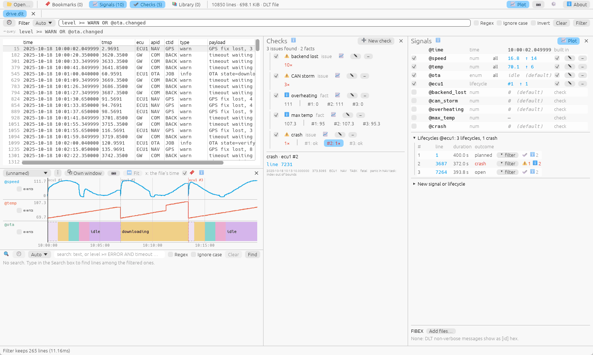

# nerka

A fast, local log viewer and analyser for big files: plain-text and JSON
logs, automotive **DLT**, and the protocols inside **pcap / pcapng** network
captures and **MF4** bus-logging files, including protocols you describe
yourself in a [Kaitai Struct](https://kaitai.io) file.

Open a multi-gigabyte trace in a second, filter it with a small query
language, split it into the boots of each ECU, let checks point at known
problems, and plot the values your logs carry. Everything runs on your
machine: a desktop viewer (`nerka-gui`) and a command-line tool (`nerka`) on
one UI-free engine (`nerka-core`).


> Status: **0.2.0-alpha.3**. Windows is the main platform;
> Linux builds come from CI; macOS isn't built yet. While nerka is at 0.x,
> file formats, the filter language and the GUI can still change.

## Features

### Big files, opened fast

Files are memory-mapped, never modified or copied, and indexed once. A
filter or a search then runs over the whole file in tens of milliseconds
(1 GiB, release build, Windows):

| 1 GiB of | Query | Time |
|---|---|---|
| text log | `search ERROR` | 34 ms |
| text log | `filter 'level >= WARN AND raw ~ /timeout/'` | 34 ms |
| DLT | `filter 'apid == NAV AND level >= WARN'` | 31 ms |
| DLT in a pcap | `filter 'apid == NAV AND level >= WARN'` | 30 ms |
| DLT | `filter 'raw ~ /timeout/'` (every message rendered) | 0.29 s |

### Filter, then search inside

Two boxes do two jobs. The **Filter** decides which lines the view shows.
The **Search** finds lines among those, lists them in a bottom pane and
colours them per query. Both take plain words, a regex, or a query in
**NFD**, nerka's filter language (see [NFD at a glance](#nfd-at-a-glance)).
Each box has an **Auto** mode (plain words are a phrase, filter syntax is a
query, they mix), a **Text** mode (literal or regex) and a strict **NFD**
mode, with history on ↑ / ↓.

```
nerka filter 'level >= ERROR AND raw ~ /SSL|CERT/i AND NOT /healthcheck/' app.log
nerka filter 'apid == NAV AND level >= WARN AND payload ~ "timeout"' trace.dlt
nerka search --in 'level >= WARN' -c timeout app.log
nerka --merge filter 'apid == NAV OR file == ecu2.dlt' ecu1.dlt ecu2.dlt bus.pcap   # several files: one view, FILE:LINE: per line
```

### Every format by its content

nerka recognises a file by its content, not its name:

- **Text** (UTF-8). Multi-line records keep a stack trace with its message
  (a tab's menu → Records…; `--records 'start=/\d{4}-\d\d-\d\d/'`).
- **JSON Lines** and **pretty JSON**: each value is a row, its keys are
  fields (`ctx.user == bob AND latency > 2.5`).
- **DLT** files. Non-verbose messages are decoded from FIBEX files, and
  their arguments can be plotted.
- **Captures**: pcap / pcapng (VLAN, IPv4 / IPv6 fragments) and MF4
  (Ethernet bus events, compressed data too). They can carry **DLT**,
  **SOME/IP** or **syslog** over UDP, or a protocol of your own (below).
  Several protocols in one capture share one table
  (`proto == SOMEIP AND service == 0x1234`).

Several files open as one view, one after another in an order you choose,
or interleaved by time. Messages of different protocols share one table:
a DLT file next to a capture of your own protocol, or captures where
different protocols are turned on. Text and JSON files join files of their
own kind.

### Your own protocols



A protocol inside captures can be described in a `.ksy` file:
[Kaitai Struct](https://kaitai.io), plus a `-nerka:` section that says
which fields, level and columns nerka shows. It is then read like a
built-in protocol: no code, no rebuild. **Rules** say which datagrams
belong to which protocol, by port, source or destination address, source
port and VLAN. They exist for the built-in protocols too. In the GUI,
definitions and rules live in ⚙ Settings → Captures: protocols, and a tab's
**Files…** window turns protocols on or off for each capture in it.

```yaml
# examples/protocols/sensor.ksy (excerpt)
seq:
  - { id: sensor, type: u2 }
  - { id: seq, type: u4 }
  - { id: kind, type: u1, enum: kind }
  - { id: value, type: s2 }
-nerka:
  name: SENSOR
  framing: datagram
  match: [ 41000 ]
  fields:
    kind: { from: kind, kind: name }
    value: value / 10.0
```

```
nerka --protocol examples/protocols/sensor.ksy filter 'kind == pressure AND value > 90' capture.pcap
nerka --protocol examples/protocols/dlt.ksy --route 'DLTK:port=3491,src=10.0.0.0/8' filter 'proto == DLTK AND level >= WARN' trace.pcap
nerka --route 'DLT:port=3490,vlan=5' --disable-protocol syslog filter 'level >= WARN' trace.pcapng
```

[`examples/protocols/dlt.ksy`](examples/protocols/dlt.ksy) describes all of
DLT, payloads included. It gives the same results as the built-in reader,
and a test checks that. Language and rules:
[doc/protocol-definitions.md](doc/protocol-definitions.md).

### Lifecycles and checks



A trace of several devices holds many boots. A **lifecycle** says which
lines belong to one device and what starts and ends its boots. Each boot
then becomes its own span, with an outcome (planned, crash, lost), and
signals can reset with it ([doc/lifecycles.md](doc/lifecycles.md)).

**Checks** are known problems written as small rules:
- a line that shows up, or a count;
- a burst (`rate 25 per 1s`) or a gap;
- an event without its answer (`missing /connected/ within 200ms`);
- a value (`value max`).

A check runs over the whole trace or per lifecycle. Its results are issues
or facts with their evidence lines, shown in a pane of their own, next to
each boot and on the command line. A check can feed another
([doc/checks.md](doc/checks.md)).

```
nerka --lifecycle 'ecu1: lines ecu == ECU1; reset uptime; planned payload ~ /shutdown/' lifecycles trace.dlt
nerka --check 'storm: lines level >= ERROR; rate 25 per 1s' check -e 2 trace.dlt
nerka --check 'lost: lines /timeout/; missing /connected/ within 200ms' check --json trace.dlt
```

### Query packs, signals and plots

The screenshot at the top shows these.

**Query packs:** queries you use again live in plain-text `.nerka-pack`
files, with parent → child refinement, labels, parameters (`$cam`) and
colours. Pick them in the library pane: they expand into plain NFD, and
each pick can colour the lines it keeps. A selection can be saved as a
preset.

**Signals and plots:** a value captured by a named regex group is a
**signal** (`@speed > 100`, `@gear.changed`). Signals are plotted over
time in lanes, with time cursors (Δt), value markers and bookmarks. A plot
can be kept by name for use on other files.

```
nerka --pack packs/ expand -l ota -p cam=CAM1
nerka-gui app.log --signal 't:time=/^(?<t>\S+ \S+)/' --signal 'lat=/latency_us=(?<lat>\d+)/' --plot lat
```

### Bookmarks, bundles, windows

- **Bookmarks with notes** (`m`, `b` / `B`) are kept next to the log as
  `<log>.nerka-marks`. They are anchored to their lines' content, so they
  survive a changed file. `bookmark` is a field: `level >= ERROR OR bookmark`.
- **Settings bundles:** packs, presets, plots, checks and signals travel as
  one readable `.nerka-bundle` file. An import shows a preview of what it
  would change, and later versions of nerka upgrade what earlier ones wrote
  ([doc/bundles.md](doc/bundles.md)).
- **Tabs and windows:** there is one tab per file or set of files. A file
  opened from the shell goes to the nerka window focused last, and windows
  can be named.

```
nerka export -o mine.nerka-bundle --only packs --only check:storm
nerka import --dry-run theirs.nerka-bundle
```

## Install

Builds for Windows (`.zip`) and Linux (`.tar.gz`, glibc 2.35+) are on the
[Releases](https://github.com/lzoledziewski/nerka/releases) page, with the
example protocol definitions in `examples/`. They are unsigned, so Windows
SmartScreen may warn on first start.

To build from source you need a stable Rust toolchain
([rustup.rs](https://rustup.rs)); on Windows, the MSVC toolchain with the
"Desktop development with C++" build tools.

```
cargo build --release --workspace
```

The binaries are `target/release/nerka-gui` and `target/release/nerka`.

## Usage

### Desktop viewer

```
nerka-gui app.log                              # open a file (several: one view)
nerka-gui trace.pcapng --query 'apid == NAV'   # open and filter
nerka-gui app.log --new-window --name triage   # a separate, named window
nerka-gui app.log --signal 'lat=/latency_us=(?<lat>\d+)/' --query '@lat > 9000'   # a signal
```

| Keys | |
|---|---|
| `Ctrl+O` | open files (or drop them on the window) |
| `Ctrl+F`, `Enter` | focus the Filter box, run it |
| `n` / `N` | next / previous search hit |
| `Ctrl+G` | go to line |
| `Enter` on a line | show the whole line (DLT: header fields and message) |
| `Ctrl+C` | copy the selection, or the current line |
| `Ctrl+click`, `Ctrl+Space` | pick single lines to copy |
| `m`, `b` / `B` | bookmark, next / previous bookmark |
| `Ctrl+Shift+L` | library and selection panes (query packs) |
| `Ctrl+Tab`, `Ctrl+W` | next tab, close tab |
| `Ctrl+,`, `F1` | settings, about |

### Command line

```
nerka filter 'level >= ERROR AND raw ~ /SSL|CERT/' app.log
nerka search -i 'timeout|refused' app.log
nerka filter 'apid == NAV AND level >= WARN' trace.dlt
nerka lines app.log 100 120
nerka open trace.pcap                                     # its lines and fields
nerka --someip-port 30501 filter 'proto == SOMEIP AND type == ERROR' trace.pcap
nerka --signal 'gear:enum=/gear=(?<gear>\w+)/' filter '@gear == D' app.log
nerka --fibex ecu1.xml filter 'apid == NAV' trace.dlt
nerka --local-time lines trace.dlt 1 20                  # local time (CLI: UTC by default; GUI: local)
```

`nerka help <command>` lists every option.

### NFD at a glance

| | |
|---|---|
| Comparisons | `== != >= <= > <`; levels compare by severity (`level >= WARN`) |
| Regex | `field ~ /re/`, `field !~ /re/`, `/re/i` ignores case |
| Text | bare `/re/` and `"text"` match the whole line (`raw`) |
| Logic | `AND OR NOT`, parentheses |
| Fields | `raw`, `level`; DLT adds `ecu apid ctid type mcnt tmsp seid mid mode payload`, SOME/IP `service method client session iface type rc len payload`, syslog `facility host app pid msgid stamp payload`, a protocol definition its own; captures `proto` and where each datagram came from: `net.src net.dst` (addresses), `net.sport net.port` (ports), `net.vlan` (fields only: not in the columns or `raw`); several files add `file`; JSON records add their keys (`ctx.user`). A key that clashes with NFD's own is `json.raw`; NFD's own are also `nfd.raw`, `nfd.level`, `nfd.bookmark` |
| Bookmarks | `bookmark` alone: a bookmarked line; `bookmark == B2` its name; `bookmark ~ /fan/` its name or note |
| Signals | `@name`: a value captured by a named regex group, of a picked query or a signal you define (📈 Signals panel, `--signal`; saved). `@gear == D` is the state (held until the next event), `@gear.event == D` a line that carries it, `@gear.changed` a change. Kinds `num`, `enum`, `time`; DLT has `@time` (receive time): `@time >= "2025-10-18 10:00:00"` |

## Documentation

- [doc/status.md](doc/status.md): current state, pending decisions and next steps.
- [doc/gui-decisions.md](doc/gui-decisions.md): the owner's decisions about the GUI.
- [doc/features.md](doc/features.md): built features and the decisions about them.
- [doc/history.md](doc/history.md): the dated log.
- [doc/architecture-analysis.md](doc/architecture-analysis.md): architecture, decisions and deviations from the
  [original spec](doc/nerka_architecture_implementation_spec_v_0.md).
- [doc/search-manager.md](doc/search-manager.md): query packs, expansion, library and selection.
- [doc/search-modes.md](doc/search-modes.md): Auto, Text and NFD modes.
- [doc/sources-and-signals.md](doc/sources-and-signals.md): input formats and signals.
- [doc/protocol-definitions.md](doc/protocol-definitions.md): protocols described in `.ksy` files, matching rules.
- [doc/lifecycles.md](doc/lifecycles.md) and [doc/checks.md](doc/checks.md): boots per device, and checks over them.
- [doc/bundles.md](doc/bundles.md): settings bundles (export, import) and how formats are upgraded.
- [CLAUDE.md](CLAUDE.md): guide for contributors and AI agents (commands, rules).

## Contributing

Issues and pull requests are welcome: see [CONTRIBUTING.md](CONTRIBUTING.md). Every commit needs a
DCO sign-off (`git commit -s`). Security problems: please report them privately, see
[SECURITY.md](SECURITY.md). Conduct: [CODE_OF_CONDUCT.md](CODE_OF_CONDUCT.md).

## License

Everything in this repository (the engine, the command-line tool, the
desktop viewer, the examples and the documentation) is licensed under
either of [Apache License 2.0](LICENSE-APACHE) or [MIT license](LICENSE-MIT),
at your option. The fonts it ships with keep their own licences
([licenses/](licenses)). Unless you state otherwise, any contribution you
submit is dual-licensed the same way, without additional terms.
