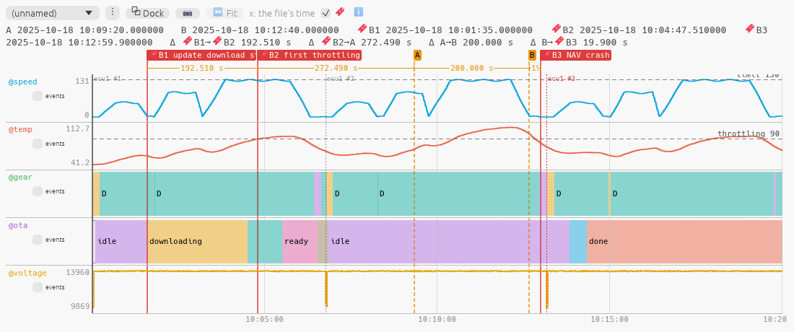
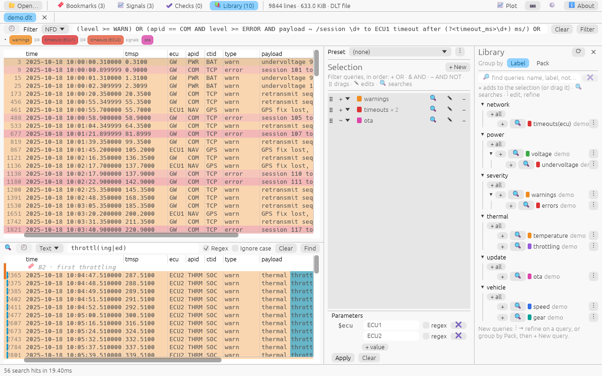
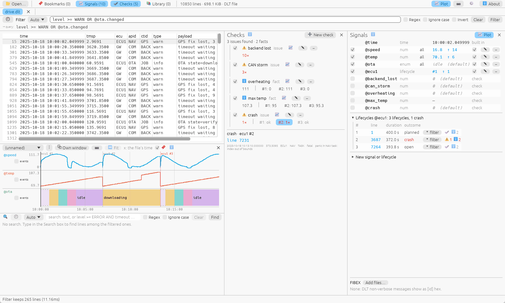

# nerka

**A fast log viewer for big files.** Open a multi-gigabyte trace in a
second, filter it in milliseconds, plot the values your logs carry and keep
the queries you use in a library. Plain-text and JSON logs, automotive
**DLT**, and what travels inside **pcap / pcapng** network captures and
**MF4** bus recordings. Everything runs on your machine.


**Download:** [latest release](https://github.com/lzoledziewski/nerka/releases/latest) (Windows, Linux, macOS on Apple Silicon) ·
**User guide:** [lzoledziewski.github.io/nerka](https://lzoledziewski.github.io/nerka/)

## Fast, on files of any size

Files are opened in place, never copied or changed, and indexed once. Then
every filter and search runs over the whole file, not just what's on screen,
and comes back in tens of milliseconds:

| On 1 GiB of | Query | Time |
|---|---|---|
| a text log | `ERROR` | 34 ms |
| a text log | `level >= WARN AND raw ~ /timeout/` | 34 ms |
| DLT | `apid == NAV AND level >= WARN` | 31 ms |
| DLT inside a pcap capture | `apid == NAV AND level >= WARN` | 30 ms |

The view scrolls through 100 million lines as smoothly as through a hundred,
and a 3 GiB capture with 30 plotted signals redraws its plot in about 12 ms.
(Release build, Windows.)

## Plots that keep up with your logs



Any value in your lines can be plotted over time: give it a name with a
regex (`speed=(?<speed>\d+)`), pick a query from the library that
captures one, or take the named arguments of DLT messages described in a
FIBEX file. Then:

- **One lane per signal:** numbers as step lines, states (a gear, an
  update's progress) as coloured bands; dashed where the value is still the
  default.
- **Click a point** and the log jumps to the line it came from; the current
  line is a cursor in the plot.
- **Time cursors** A, B, … with the Δt between them, like a logic analyser;
  **bookmarks** with notes take part too.
- **Markers** for limits and thresholds (`throttling 90`).
- **Boots and runs** of each device as labelled spans.
- **Docked** under the log **or in its own window**, as you last chose; the
  window comes back where it was, maximized or not.
- **Keep a plot by name** and open it on the next trace with all its lanes.
- Signals are queries too: `@speed > 100 AND level >= WARN`, `@gear.changed`.

[Signals and plots →](https://lzoledziewski.github.io/nerka/user/signals.html)

## A library of the queries you know



The questions you ask every trace ("warnings", "timeouts to this ECU",
"the update's state") become queries in a **library**, grouped by label and
shared with your team as plain-text files that merge well in git.

- **Pick** a few: the view keeps their lines, each in its own colour.
- **Refine**: a query can build on another (`errors` within `warnings`).
- **Parameters**: one `timeouts(ecu)` query, picked for ECU1 and ECU2,
  becomes two, each with its colour.
- **Signals for free**: a query's named regex groups become signals to
  plot.
- **Presets** save a whole analysis (picks, colours, values, the boxes'
  text) to run again on the next file.

A query is written in NFD, nerka's small query language: fields, levels,
regexes, parameters. The one open in the screenshot at the top:

```
## Sessions to one ECU that timed out; @timeout_ms: how long each waited.
query timeouts(ecu)  labels: network  color: red
    apid == COM AND level >= ERROR
    AND payload ~ /session \d+ to $ecu timeout after (?<timeout_ms>\d+) ms/
```

Picked for ECU1 and ECU2, it becomes two queries with the parameter filled in;
the Filter box shows the result, and `@timeout_ms` is a signal ready to
plot.

[The Library →](https://lzoledziewski.github.io/nerka/user/library.html)

## And also

- **Every format by its content:** text (with multi-line records such as
  stack traces), JSON Lines and pretty JSON (keys become fields), DLT
  (verbose, and non-verbose with FIBEX), pcap / pcapng and MF4 carrying DLT,
  SOME/IP, syslog or a protocol of your own. Several files open as one
  view, one after another or interleaved by time.
- **Filter, then search inside:** two boxes, two jobs. Plain words, a
  regex, or a small query language:
  `level >= ERROR AND payload ~ /SSL|CERT/i AND NOT /healthcheck/`.
- **Boots and checks:** split a trace into the boots of each ECU (planned,
  crash, lost) and let checks point at known problems: bursts, gaps, an
  event without its answer, a value out of range.

  
- **Your own protocols:** describe a datagram format in a
  [Kaitai Struct](https://kaitai.io) `.ksy` file and nerka reads it like a
  built-in one, no code and no rebuild.
- **Bookmarks with notes** that survive a changed file, a **command line**
  (`nerka filter …`) with the same engine for scripts, and **settings
  bundles** to hand your library, plots and checks to a colleague.

## Install

Download the archive for your system from the
[releases page](https://github.com/lzoledziewski/nerka/releases/latest) and
unpack it anywhere; there is no installer.

- **Windows:** `nerka-…-windows-x86_64.zip`. The binaries are unsigned, so
  SmartScreen may warn the first time.
- **Linux:** `nerka-…-linux-x86_64.tar.gz` (glibc 2.35 or newer, e.g.
  Ubuntu 22.04).
- **macOS (Apple Silicon):** `nerka-…-macos-aarch64.tar.gz`; clear the
  download mark once (`xattr -dr com.apple.quarantine <folder>`), then start
  `./nerka-gui`.

Each archive holds `nerka-gui` (the viewer), `nerka` (the command line),
examples and the user guide. Building from source:
[CONTRIBUTING.md](CONTRIBUTING.md).

## First steps

Start `nerka-gui` and drop a file on the window, or:

```
nerka-gui trace.dlt                          # open a file (several: one view)
nerka-gui app.log --query 'level >= WARN'    # open and filter
```

Type in the **Filter** box at the top (`timeout`, `level >= ERROR`,
`apid == NAV AND payload ~ /speed=\d+/`) and press Enter. `Enter` on a line
shows all of it, `m` bookmarks it, 📚 **Library** opens the library, 📈
**Signals** the signals to plot.

The same engine on the command line:

```
nerka filter 'level >= ERROR AND raw ~ /SSL|CERT/' app.log
nerka search -i 'timeout|refused' app.log
nerka open trace.pcap        # what's in the file: lines, fields, protocols
```

The [user guide](https://lzoledziewski.github.io/nerka/) has the rest,
from [getting started](https://lzoledziewski.github.io/nerka/user/getting-started.html)
to every command and option.

nerka is at 0.x: file formats, the query language and the window can still
change. Windows is where it is used most; Linux and macOS builds are tested
automatically.

## Contributing

Issues and pull requests are welcome: see [CONTRIBUTING.md](CONTRIBUTING.md)
(building, the rules of the code base, the project's working notes). Every
commit needs a DCO sign-off (`git commit -s`). Security problems: please
report them privately, see [SECURITY.md](SECURITY.md). Conduct:
[CODE_OF_CONDUCT.md](CODE_OF_CONDUCT.md).

## License

Everything in this repository (the engine, the command-line tool, the
desktop viewer, the examples and the documentation) is licensed under
either of [Apache License 2.0](LICENSE-APACHE) or [MIT license](LICENSE-MIT),
at your option. The fonts it ships with keep their own licences
([licenses/](licenses)). Unless you state otherwise, any contribution you
submit is dual-licensed the same way, without additional terms.
