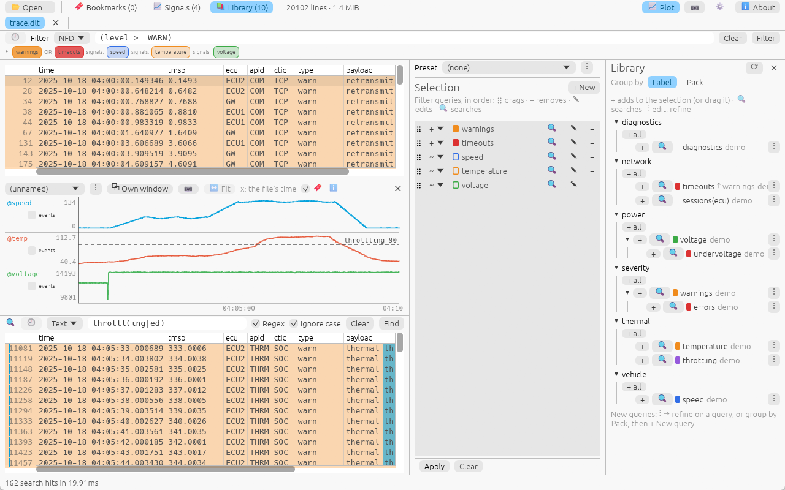

# nerka

Fast log analysis for big files: filter, search, plot signals, follow
device boots and run checks over plain text, JSON, DLT and network
captures (pcap, pcapng, MF4). A desktop viewer (`nerka-gui`) and a command
line tool (`nerka`), both on one engine.

- **Download:** [the latest release](https://github.com/lzoledziewski/nerka/releases/latest)
  (Windows `.zip`, Linux `.tar.gz`), or [every release](https://github.com/lzoledziewski/nerka/releases)
  including pre-releases.
- **Source, issues and discussion:** [github.com/lzoledziewski/nerka](https://github.com/lzoledziewski/nerka).

## User guide

1. [Getting started](user/getting-started.md): install, open a file, the first filter.
2. [The desktop viewer](user/gui.md): tabs, the Filter and Search boxes, bookmarks, keys.
3. [The command line](user/cli.md): every command and option.
4. [Queries (NFD)](user/queries.md): the filter language, and how the boxes read what you type.
5. [Files and formats](user/formats.md): text, records, JSON, DLT, captures, several files as one view.
6. [Query packs and presets](user/packs.md): a library of queries you use again.
7. [Signals and plots](user/signals.md): values taken from lines, plotted over time.
8. [Lifecycles](user/lifecycles.md): boots and runs of a device, and their outcomes.
9. [Checks](user/checks.md): issues and facts found per log or per lifecycle.
10. [Protocol definitions](user/protocol-definitions.md): your own protocols in captures, in `.ksy` files.
11. [Settings bundles](user/bundles.md): export and import your setup.
12. [Settings and where things are kept](user/settings.md).

nerka is at 0.x: file formats, the filter language and the GUI can still
change. Licensed under MIT or Apache-2.0.
