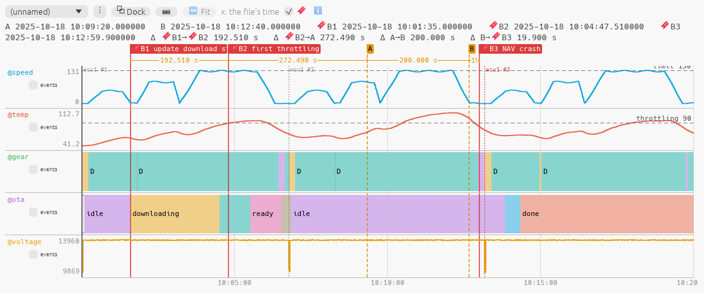
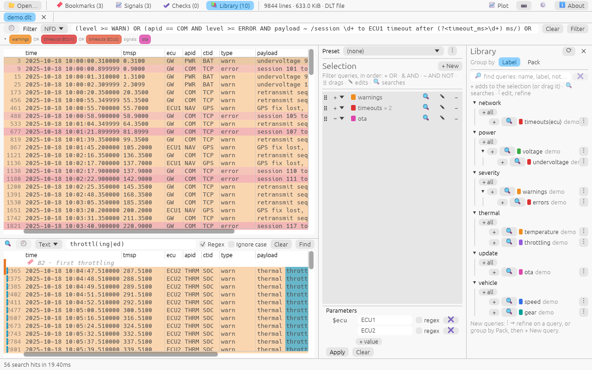

# nerka

**A fast log viewer for big files.** Open a multi-gigabyte trace in a
second, filter it in milliseconds, plot the values your logs carry and keep
the queries you use in a library. Plain-text and JSON logs, automotive DLT,
and what travels inside pcap / pcapng captures and MF4 bus recordings.
Everything runs on your machine.

**[Download nerka](https://github.com/lzoledziewski/nerka/releases/latest)**
(Windows, Linux, macOS on Apple Silicon; no installer) ·
[source and issues](https://github.com/lzoledziewski/nerka) ·
[start here](user/getting-started.md)

## Fast, on files of any size

Files are opened in place and indexed once; then every filter and search
runs over the whole file in tens of milliseconds: `apid == NAV AND level >=
WARN` over 1 GiB of DLT in 31 ms, the same inside a pcap capture in 30 ms,
`ERROR` over 1 GiB of text in 34 ms. A view of 100 million lines scrolls like
one of a hundred.

## Plots that keep up with your logs

Name a value with a regex, pick it from the Library, or take it from a
FIBEX file, and it is plotted over time: numbers as lines, states as
coloured bands, boots as spans. Click a point to jump to its line; place
time cursors and read the Δt; mark limits; keep the plot for the next
trace. [Signals and plots →](user/signals.md)

## A library of the queries you know

Write a query once ("warnings", "timeouts to this ECU", "the update's
state"), keep it in the Library and pick it on every trace: each pick
colours its lines, a parameter picks one query for several ECUs, named
groups become signals, a preset saves the whole analysis. The Library is
plain-text files you can share in git. [The Library →](user/library.md)

## What a log says, in patterns

**🧩 Patterns** groups a log's messages into templates, the parts that
vary as slots (`gear={D|P|N}`, `session <*> to <*>`), the rarest first:
a million lines read as a page of messages. **⚖ Compare** puts two sets
side by side (two boots, a good run and a bad one, two files) and lists
the patterns and values new, gone or more frequent, or what stayed the
same. Experimental, and tunable on the trace at hand.
[Patterns →](user/gui.md#patterns)

## Your AI agent, on your logs

nerka ships no model: bring Claude Code, Codex, Gemini CLI or another.
On its own, an agent analyses any file with the command line (JSON in
pages, a guide written for it); with you, **🤖 AI** opens it in a
terminal working on your window through MCP: it reads what you have open,
filters, plots and leaves its findings as 🤖 annotations you accept or
undo. [AI agents →](user/agents.md)

## User guide

1. [Getting started](user/getting-started.md): install, the demo trace, the first filter.
2. [The desktop viewer](user/gui.md): tabs, the Filter and Search boxes, bookmarks, patterns, keys.
3. [The Library](user/library.md): queries you use again, presets.
4. [Signals and plots](user/signals.md): values taken from lines, plotted over time.
5. [Queries (NFD)](user/queries.md): the filter language, and how the boxes read what you type.
6. [Files and formats](user/formats.md): text, records, JSON, DLT, captures, several files as one view.
7. [Lifecycles](user/lifecycles.md): boots and runs of a device, and how each ended.
8. [Checks](user/checks.md): known problems found per log or per boot.
9. [The command line](user/cli.md): every command and option.
10. [AI agents](user/agents.md): an agent of your choice, with the command line or on your window (MCP), its findings as annotations.
11. [Protocol definitions](user/protocol-definitions.md): your own protocols in captures, in `.ksy` files.
12. [Settings bundles](user/bundles.md): export and import your setup.
13. [Settings and where things are kept](user/settings.md).

nerka is at 0.x: file formats, the query language and the window can still
change. Licensed under MIT or Apache-2.0.
