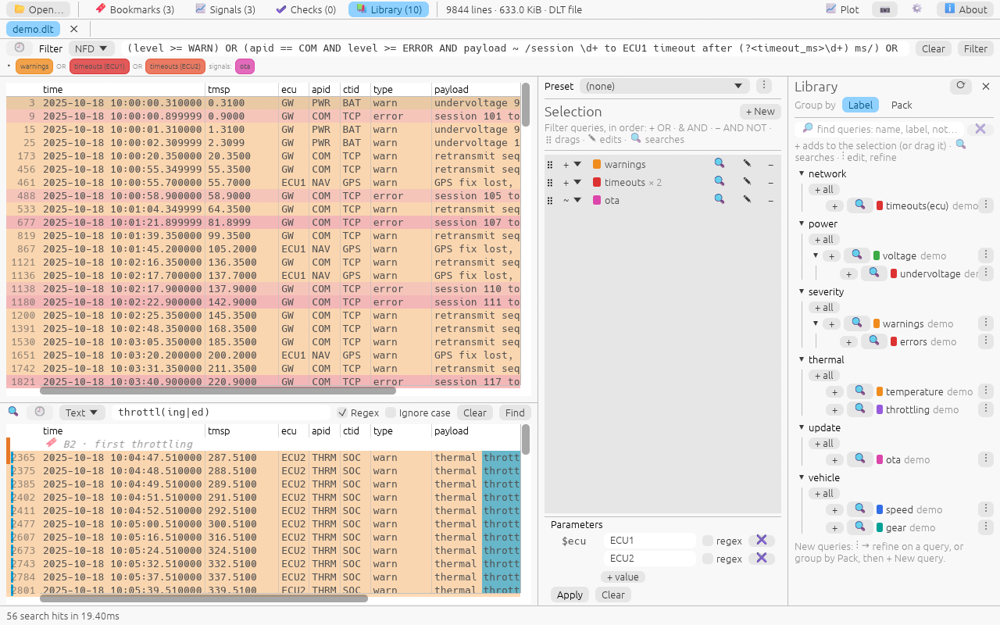

# The Library

The questions you ask of every trace ("warnings", "timeouts to this ECU",
"the update's state") are queries you write once and keep in the
**Library**. Pick a few for a file: the view keeps their lines, each in its
own colour, their named regex groups become [signals](signals.md) to plot,
and a **preset** saves the whole analysis for the next file. The Library is
kept in plain-text files ([packs](#library-files-packs)) that you can share
with your team.



nerka expands the picks into a plain query (NFD, [Queries](queries.md)),
which is what runs and what the Filter box shows.

## Try it

On the demo trace that comes with nerka
([Getting started](getting-started.md#try-the-demo)) and its queries:

```
nerka-gui examples/demo.dlt --pack examples/packs/demo.nerka-pack --library
```

1. In the Library on the right, click `+` next to **warnings** and next to
   **timeouts(ecu)**: both go into the Selection.
2. Under **Parameters**, type `ECU1` for `$ecu`, then **+ value** and
   `ECU2`: the timeouts query is now picked once per ECU (`× 2`).
3. **Apply**: the Filter box gets the query they make, and the view keeps
   their lines.
4. Click a pick's colour swatch: its lines are coloured.
5. Add **speed** and switch its role (the `+ ▾` box) to `~` (signals only):
   `@speed` is now a signal, ready to plot from 📈 **Signals**.
6. **New from this tab…** above the Selection keeps all of it as a preset.

## Library and selection

📚 (`Ctrl+Shift+L`) opens two panes:

- The **Library**: queries grouped by label (or by pack), refining queries
  under their parent. `+` (or dragging a name) adds one to the selection,
  `🔍` searches for it, `⋮` edits it, refines it, excludes it, or adds it
  without its parents. A query using fields the open file doesn't have is
  greyed out.
- The **Selection**: what this tab picked, each with a role:
  - **Include** (`+`): the filter keeps lines of any included query;
  - **Exclude** (`−`): and leaves out lines of an excluded one;
  - **Signal** (`~`): not part of the filter; its named groups become
    [signals](signals.md), and it can colour the lines it matches.

  Parameters get their values here. Each include can colour the lines it
  keeps (click its swatch). `✎` edits a node; **Save to** writes it into a
  pack (or **Create** a new one). **+ New** starts a query of your own.

Applying the selection puts its expansion in the Filter box (NFD mode).

### Instances of a parameterised query

To track several cameras with one `drops(cam)` query, give `$cam` several
values in **Parameters**: **+ value** adds a field (so does + on the query
in the library once it is picked), ✖ removes one. Every picked query
using `$cam` is then an **instance** per value, a part of its own:
`drops (CAM1)`, `drops (CAM2)`, each with its colour, and the selection
shows the count next to it (`× 2`). With two such parameters, every
combination. A value counts once you press Enter or leave its field; an
empty field or a value given twice (⚠) adds nothing. Instances share the
query's text and settings: editing the query edits them all.

Signals follow the query's group names: `(?<drops_$cam>…)` gives each
instance its signal (`@drops_CAM1`, `@drops_CAM2`); `(?<drops>…)` is one
signal fed by every instance (its row in the Signals panel says
`query ← 2`). A `signals:` line can use the parameters the same way:

```
query drops(cam)  signals: drops_$cam:num:default(0)
    /$cam drop (?<drops_$cam>\d+)/
```

An option there may use only the parameters its name uses (instances that
share a signal share its options). On the command line, give a parameter
several times: `-p cam=CAM1 -p cam=CAM2` (`nerka-gui --param` likewise);
presets keep the values as `param cam = CAM1` and `param cam += CAM2`.

## Presets

A **preset** saves a tab's analysis to use again on other files: the
selection in order (roles, line colours, instances), copies of queries you
edited or made, the parameter values, and the text typed in the Filter and Search
boxes. Choosing one replaces the tab's selection and runs both boxes.

The bar above the Selection pane: **New from this tab…** → **Keep** (this
session, marked `•`) or **Save**; **Update 'name' from this tab**; **Save to
disk**; **Delete**. Renaming or deleting a library query updates the
presets that pick it. Saved presets are `%APPDATA%\nerka\presets\NAME.nerka-preset`
and travel in [settings bundles](bundles.md).

## Library files (packs)

The library is read from **packs**: plain-text `.nerka-pack` files, one
per team or topic, that merge well in git and can be shared. Every query
in the library belongs to one; **Save to** in the Selection writes into
them, or edit them in any text editor.

```text
# A comment: '#' in column 1, or ' #' followed by a space.
pack vision   # camera team

## The camera's lines: a note for whoever picks it (lines starting '##').
query cam_scope(ecu, cam)  labels: system/vision
    ecu == $ecu AND ctid == $cam

query frame_drops(cam)  parent: cam_scope  labels: system/vision, perf  color: violet
    payload ~ /$cam frame drop/
```

- `pack NAME` is the first line that isn't a comment; one pack per file.
  Names are letters, digits and `_`, or quoted to hold spaces
  (`pack "camera team"`, `query "xyz logs"`).
- `query NAME(PARAMS)` then, in any order and all optional:
  - `parent:` a query it refines (of this pack, or `pack.query`): its
    meaning is `parent AND its own text`;
  - `labels:` comma-separated, `/` for a hierarchy (`system/vision`);
  - `color:` a name or `#rrggbb`, for the lines it keeps;
  - `signals:` options for its named groups as [signals](signals.md):
    `GROUP:OPTIONS`, comma-separated, the options being those of a saved
    signal (`num`, `enum`, `time`, `filtered`, `per(LIFECYCLE)`,
    `default(VALUE)`, joined by `:`). Example:
    `signals: t:time, ota:enum:per(ecu1):default(idle)`. What isn't given
    is worked out (the kind from the first values). The Signals panel can
    change them for a tab; 💾 (**Save to pack**) writes them here. An entry for
    a group no regex of the query (or its parents) captures is listed as a
    warning at the top of the Library, and removed when the query is saved.
- The **body** is the indented lines below, kept as written.
- `$name` or `${name}` is a **parameter**, declared in the query's list.
  `$$` is a `$`; so is a `$` not followed by a name (`/down$/`).
- `##` lines right above a query are its **note**, shown in the library.
- Errors are reported as `file:line:column: message`; field names are
  checked when a query runs on a file.

Your packs are in `%APPDATA%\nerka\packs\` (Linux: `~/.config/nerka/packs/`);
the CLI's `--pack DIR|FILE` and the GUI's `--pack` load more. Pack names
must be unique. Samples: `examples/packs/`.

## Expansion

Included queries are joined with `OR`, each with its parent chain
(`(parent) AND (query)`); excluded ones follow as `AND NOT …`.
Parameter values are **escaped** where they stand: inside a regex as
literal text, inside a string as a string, as a bare value as a quoted
string. So `cam=CAM(1)` can't widen a regex. A raw value (regex syntax) has
to be asked for: CLI `--raw-param`.

A label is resolved when you pick it: a query added to a pack later doesn't
join a filter already applied.

```
nerka --pack examples/packs/ expand -l ota -p cam=CAM1 --parts
```
