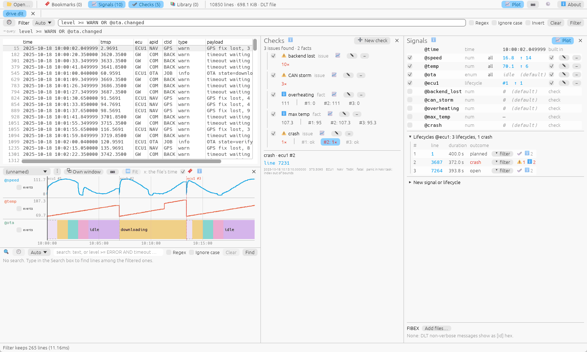

# Lifecycles

A **lifecycle** is one run of something: a boot of an ECU, a start of an
app. nerka finds where each starts and how it ended, and reports where the
log and the definition disagree.



## Defining one

```
ecu1: lines ecu == ECU1; reset uptime; planned {sys.shutdown}
gw: lines ecu == GW; reset uptime tolerance 2s; planned payload ~ /shutdown requested/
app: lines apid == NAV; start payload ~ /NAV started/; crash payload ~ /panic/
```

`NAME: CLAUSES`, clauses separated by `;`:

| Clause | Meaning |
|---|---|
| `lines QUERY` | the entity's lines (default: every line) |
| `reset uptime [tolerance 5s]` | a new one starts when the uptime its lines carry (DLT's `tmsp`) goes back by more than the tolerance (default 5 s) |
| `reset @signal [tolerance …]` | … when a number signal goes back (an uptime read from a text log, `[   12.3]`) |
| `start QUERY` | … when one of its lines matches |
| `gap 30s` | … when its lines stop for longer; the one before ends as `lost` |
| `planned QUERY`, `crash QUERY` | how it ended: the last such line in it wins |
| `late 10s` | a first line above this uptime is a "late start" |

A `QUERY` is NFD or a library query: `{pack.query}`, `{sys.of ecu=ECU1}`
with parameters ([Query packs](packs.md)). A query's name is written as it
is, spaces included (`{Aurix logs.Fusa Fault}`); one holding a word like
`x=1` is quoted (`{"pack.q x=1" cam=CAM1}`). A `;` inside a query, a
regex or a string doesn't end the clause.

Define one in the 📈 Signals panel (**New signal or lifecycle** → a form
with **Preview**), with `--lifecycle SPEC` (CLI; the GUI takes it for the
session), or in the saved signals file as `lifecycle …`.

## What you get

A lifecycle lasts from its first line to the next one's first line; every
line in between is in it, whoever wrote it.

| Outcome | When |
|---|---|
| `planned` | a `planned` line is in it |
| `crash` | a `crash` line is in it |
| `unclean` | neither, and a new one started |
| `lost` | it ended by a `gap` |
| `open` | the log ends in it |

**Findings** check the definition against the uptime: a *missed reset*
(the uptime went back but nothing started one), a *false reset* (one
started but the uptime kept counting), a *late start*, and a *spread* of
the boot time that is too wide. A finding that repeats is listed once with
how often.

## Using lifecycles

- **In queries:** `@ecu1` is the number of the lifecycle a line is in:
  `@ecu1 == 2 AND ecu == GW` is GW's lines during ECU1's second boot;
  `@ecu1.event` is a line where one starts.
- **Signals per lifecycle:** `ota(s):enum:per(ecu1):default(idle)=…`
  resets at each start ([Signals](signals.md)), so a state doesn't leak
  from one boot into the next.
- **Checks per lifecycle:** `…; per ecu1` ([Checks](checks.md)).
- **The Signals panel** lists each lifecycle: number, first line (click: go
  there), duration, outcome, what its checks found, `▾ filter` (its lines).
- **The plot** labels where each plotted lifecycle starts.

```
nerka --lifecycle 'ecu1: lines ecu == ECU1; reset uptime; planned payload ~ /shutdown/' lifecycles trace.dlt
nerka --lifecycle 'ecu1: lines ecu == ECU1; reset uptime' lifecycles --count 'level >= ERROR' trace.dlt
nerka --lifecycle 'ecu1: lines ecu == ECU1; reset uptime' filter '@ecu1 == 2 AND level >= ERROR' trace.dlt
```

`nerka lifecycles` prints a table (findings on stderr); `--json`,
`--strict` (exit 1 on a finding), `--count QUERY` per lifecycle.
